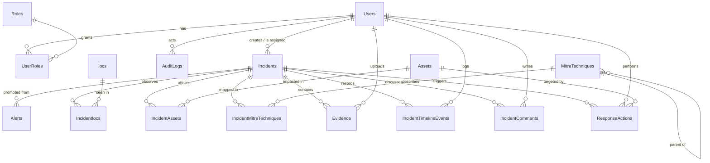

# Database Design

> **Status:** DESIGN — agreed 2026-08-22. No migration exists yet; nothing here is
> implemented. This document is the specification the first migration must match,
> and must be corrected if the implementation ends up differing.

**Engine:** MySQL 8.0.43 · **Access:** EF Core 10 with Pomelo provider · **Schema
changes:** EF Core migrations only, never hand-edited SQL.

---

## 1. Conventions

| Convention | Choice |
|---|---|
| Primary keys | `int` auto-increment, named `Id`. Surrogate keys everywhere — natural keys change |
| Foreign keys | `<Entity>Id`, indexed (MySQL/InnoDB indexes FK columns automatically) |
| Timestamps | `datetime(6)`, **always UTC**, named `...At` |
| Enums | Stored as `varchar` strings, not integers (see `architecture.md` §5) |
| Strings | Explicit `MaxLength` on every column — no unbounded `longtext` by accident |
| Deletes | `ON DELETE RESTRICT` by default; cascade only where a child cannot exist alone |
| Join tables | Composite PK on the two FKs, plus their own metadata columns |
| Naming | Plural table names (`Incidents`), singular entity classes (`Incident`) |

**Character set:** `utf8mb4` / `utf8mb4_0900_ai_ci`. Required — IOCs and evidence
filenames contain arbitrary international text, and MySQL's legacy `utf8` is a
3-byte impostor that cannot store all of Unicode.

---

## 2. ERD



17 tables: 9 primary entities, 4 join tables, 3 supporting (`Roles`, `AuditLogs`,
`IncidentNumberSequences`), 1 reference table (`MitreTechniques`).

---

## 3. The three decisions that matter

Everything else in this schema is mechanical. These three would be expensive to
reverse, so they are argued explicitly.

### 3.1 IOCs are a global catalog, not per-incident rows

**Rejected:** an `Iocs` table with `IncidentId` — each incident owns its own IOC rows.

**Chosen:** a global, deduplicated IOC catalog with a `UNIQUE (Type, Value)`
constraint, joined to incidents through `IncidentIocs`.

Why: the entire analytical value of IOC tracking is the question *"have we seen
this before?"* If `185.220.101.5` is stored as five unrelated rows across five
incidents, that question requires a string scan and returns nothing useful. With a
catalog it is one row with five links, and correlation becomes a join.

The split of attributes follows from this:

- **On `Iocs` (intrinsic to the indicator):** type, value, confidence, malicious
  verdict, source, first/last seen, times seen. These are properties of the
  indicator itself and are true regardless of which incident you are viewing.
- **On `IncidentIocs` (contextual to the sighting):** the indicator's role in
  *this* incident, who added it, when. "This hash was the dropper" is a fact about
  a sighting, not about the hash.

Cost accepted: normalising `Value` (lowercase domains, strip `hxxp://`
defanging, IPv6 canonical form) becomes mandatory before insert, or the unique
constraint is defeated by `EVIL.COM` vs `evil.com`. Normalisation happens in the
service layer on write, and the raw input is kept in `RawValue` for provenance.

### 3.2 Alert → Incident is many-to-one, not many-to-many

**Chosen:** `Alerts.IncidentId` — a nullable FK. Many alerts can point at one
incident; an alert points at zero or one.

Why: this satisfies the stated requirement ("one incident may be related to
multiple alerts") with a single indexed column and no join table. The reverse
case — one alert belonging to two incidents simultaneously — is not a real SOC
workflow. If two incidents both need the same alert, the correct move is merging
the incidents, not fanning out the alert. Microsoft Sentinel and TheHive both
model it this way.

An alert's lifecycle is therefore: `NEW` → analyst reviews →
either `FALSE_POSITIVE` (closed, `IncidentId` stays null) or `PROMOTED`
(`IncidentId` set, either to a new incident or an existing one). `Alerts` also
carries `DeduplicationKey` so a SIEM connector re-sending the same alert does not
create duplicates.

Migration path if this is ever wrong: add `AlertIncidents`, backfill from the FK,
drop the column. Cheap, and only if reality demands it.

### 3.3 Incident numbers come from a counter table, not `MAX() + 1`

Human-facing incident numbers (`INC-2026-000042`) are what analysts say out loud
and paste into tickets. They must be gapless-ish, year-scoped, and — critically —
never duplicated.

**Rejected:** `SELECT MAX(IncidentNumber) + 1`. Two concurrent creates read the
same maximum and produce the same number. This is a textbook race, and it *will*
fire the first time two analysts triage a burst of alerts at once.

**Chosen:** an `IncidentNumberSequences` table keyed by year, incremented with a
row lock inside the same transaction that inserts the incident:

```sql
START TRANSACTION;
  SELECT LastValue FROM IncidentNumberSequences WHERE Year = 2026 FOR UPDATE;
  UPDATE IncidentNumberSequences SET LastValue = LastValue + 1 WHERE Year = 2026;
  INSERT INTO Incidents (IncidentNumber, ...) VALUES ('INC-2026-000043', ...);
COMMIT;
```

`SELECT ... FOR UPDATE` serialises concurrent creators on that single row. A
`UNIQUE` index on `Incidents.IncidentNumber` remains as a backstop: if the logic
is ever wrong, the database refuses the duplicate rather than allowing two
incidents to share an identity.

Note the deliberate separation of `Id` (surrogate, internal, used in FKs and URLs)
from `IncidentNumber` (human identifier). Using the display number as the PK would
tie every foreign key to a formatting decision.

---

## 4. Core tables

### 4.1 Users

| Column | Type | Notes |
|---|---|---|
| Id | int PK | |
| Email | varchar(256) | **UNIQUE**, login identifier, stored lowercase |
| FullName | varchar(150) | |
| PasswordHash | varchar(255) | ASP.NET Core Identity PBKDF2 format; never a plaintext or reversible value |
| JobTitle | varchar(100) NULL | e.g. "Tier 2 SOC Analyst" |
| IsActive | bool | Default `true` |
| LastLoginAt | datetime(6) NULL | |
| FailedLoginAttempts | int | Default 0, for lockout |
| LockedOutUntil | datetime(6) NULL | |
| CreatedAt / UpdatedAt | datetime(6) | |

**Users are never deleted, only deactivated.** They are referenced by audit logs,
timeline events and evidence — deleting one would either destroy an audit trail or
orphan it. `IsActive = false` blocks login and hides them from assignee pickers
while preserving history.

Indexes: `UNIQUE (Email)`, `(IsActive)`.

### 4.2 Roles / UserRoles

`Roles`: `Id`, `Name` UNIQUE (`ADMIN`, `SECURITY_MANAGER`, `SOC_ANALYST`),
`Description`.

`UserRoles`: composite PK `(UserId, RoleId)`, plus `AssignedAt`, `AssignedById`.

A join table rather than a single `Role` enum column on `Users`, because a lead
analyst genuinely can be both `SOC_ANALYST` and `SECURITY_MANAGER`, and because
role *assignment* is itself a security-relevant event worth attributing
(`AssignedById`). Roles are seeded, not user-creatable — the API exposes no
"create role" endpoint, since the code enforces policies against known names.

### 4.3 Incidents

| Column | Type | Notes |
|---|---|---|
| Id | int PK | Internal identity |
| IncidentNumber | varchar(20) | **UNIQUE**, `INC-{year}-{6 digits}` |
| Title | varchar(200) | |
| Description | text | |
| Severity | varchar(20) | `LOW` `MEDIUM` `HIGH` `CRITICAL` |
| Priority | varchar(20) | `LOW` `MEDIUM` `HIGH` `URGENT` |
| Status | varchar(20) | 9 lifecycle values, below |
| Category | varchar(30) | 10 values, below |
| Source | varchar(20) | How it arrived: `SIEM` `EDR` `FIREWALL` `IDS` `EMAIL_SECURITY` `MANUAL` `USER_REPORT` `THREAT_INTEL` |
| CreatedById | int FK → Users | RESTRICT |
| AssignedToId | int FK → Users NULL | RESTRICT; null = unassigned queue |
| DetectedAt | datetime(6) NULL | When the activity was detected (may precede creation) |
| CreatedAt | datetime(6) | When the record was made |
| UpdatedAt | datetime(6) | |
| TriagedAt | datetime(6) NULL | Lifecycle milestones, set on transition |
| ContainedAt | datetime(6) NULL | |
| ResolvedAt | datetime(6) NULL | |
| ClosedAt | datetime(6) NULL | |
| ResolutionSummary | text NULL | Required to close |
| FalsePositiveReason | varchar(500) NULL | Required for `FALSE_POSITIVE` |
| Version | int | Optimistic concurrency token |

**Milestone timestamps are separate nullable columns, not derived from the
timeline.** They are what every dashboard metric is computed from — mean time to
detect, to contain, to resolve. Deriving them by scanning timeline events on every
dashboard load would be both slow and fragile.

**`DetectedAt` vs `CreatedAt`** is a real distinction, not redundancy: an
intrusion detected at 02:14 by a SIEM rule but triaged by a human at 08:30 has two
genuinely different timestamps, and MTTD is meaningless if you conflate them.

Indexes:
- `UNIQUE (IncidentNumber)`
- `(Status)`, `(Severity)`, `(Category)` — the standard dashboard filters
- `(AssignedToId, Status)` — composite, for "my open incidents", the single most
  frequent analyst query
- `(CreatedAt)`, `(DetectedAt)` — date-range filters and time-series charts
- `(Status, Severity)` — composite, for the open-critical dashboard tile

`Version` is an `int` concurrency token incremented on save, not SQL Server's
`rowversion` — MySQL has no auto-updating binary row version, so EF Core is
configured with `IsConcurrencyToken()` and the service increments it. Two analysts
saving the same incident: the second gets a 409 Conflict instead of silently
erasing the first one's work.

#### Enum values

**Status** — `NEW`, `TRIAGED`, `INVESTIGATING`, `CONTAINED`, `ERADICATED`,
`RECOVERING`, `RESOLVED`, `CLOSED`, `FALSE_POSITIVE`.
Transition rules are **not** designed yet (deliberately deferred). For now the
column accepts any valid value and the service records every change; the state
machine gets designed as its own step.

**Category** — `MALWARE`, `PHISHING`, `ACCOUNT_COMPROMISE`, `NETWORK_ATTACK`,
`DATA_EXFILTRATION`, `RANSOMWARE`, `INSIDER_THREAT`, `VULNERABILITY`,
`UNAUTHORIZED_ACCESS`, `OTHER`.

#### Severity vs Priority

Two columns, because they answer different questions and routinely disagree.

**Severity = how bad is this threat, technically?** A property of the incident
itself: blast radius, data sensitivity, attacker capability, whether it is still
active. Ransomware encrypting a file server is `CRITICAL` regardless of anything
else.

**Priority = what should be worked on next?** A scheduling decision that combines
severity with business context: asset criticality, exposure, SLA commitments,
whether containment already happened, who is available.

They diverge constantly:

| Scenario | Severity | Priority | Why |
|---|---|---|---|
| Ransomware on an isolated, decommissioned lab VM | `CRITICAL` | `LOW` | Severe malware, zero business impact, already contained by isolation |
| Phishing email opened by the CFO | `MEDIUM` | `URGENT` | Ordinary technique, but a finance-authority account is at stake |
| Old unexploited CVE on an internal server | `HIGH` | `LOW` | Serious in principle, no evidence of exploitation |
| Port scan from the internet | `LOW` | `LOW` | Background noise; they agree |

Collapsing them into one field forces analysts to lie about one to express the
other — logging fake `CRITICAL`s to get attention, which destroys the severity
metrics. Severity is assigned by the analyst who triages; priority is a management
lever a `SECURITY_MANAGER` can override.

### 4.4 Alerts

| Column | Type | Notes |
|---|---|---|
| Id | int PK | |
| Title | varchar(200) | |
| Description | text NULL | |
| Source | varchar(20) | `SIEM` `EDR` `FIREWALL` `IDS` `EMAIL_SECURITY` `MANUAL` |
| SourceRuleId | varchar(100) NULL | Rule/signature id from the origin system |
| ExternalId | varchar(100) NULL | Id in the source system, for round-tripping |
| DeduplicationKey | varchar(200) NULL | **UNIQUE**; lets a connector re-send safely |
| Severity | varchar(20) | Source-reported severity |
| Status | varchar(20) | `NEW` `IN_REVIEW` `FALSE_POSITIVE` `PROMOTED` `CLOSED` |
| RawPayload | json NULL | Original event, kept verbatim for forensics |
| IncidentId | int FK → Incidents NULL | Set on promotion; SET NULL on incident delete |
| TriagedById | int FK → Users NULL | |
| DetectedAt | datetime(6) | When the source fired |
| ReceivedAt | datetime(6) | When we ingested it |
| TriagedAt | datetime(6) NULL | |

`RawPayload` as MySQL `json` rather than parsed columns: alert shapes differ per
vendor and change without notice. Store the original untouched, project what we
need into typed columns. It is evidence.

Indexes: `(Status)`, `(IncidentId)`, `(Source)`, `(DetectedAt)`,
`UNIQUE (DeduplicationKey)`.

### 4.5 Iocs / IncidentIocs

**`Iocs`** — the global catalog:

| Column | Type | Notes |
|---|---|---|
| Id | int PK | |
| Type | varchar(20) | `IP_ADDRESS` `DOMAIN` `URL` `HASH_MD5` `HASH_SHA1` `HASH_SHA256` `EMAIL` `FILE_NAME` `REGISTRY_KEY` `USER_AGENT` |
| Value | varchar(512) | **Normalised** (lowercased, defanging removed) |
| RawValue | varchar(512) NULL | As originally submitted, for provenance |
| Confidence | varchar(20) | `LOW` `MEDIUM` `HIGH` `CONFIRMED` |
| IsMalicious | bool NULL | Tri-state: null = unverified, not "benign" |
| Source | varchar(100) NULL | Where the indicator came from |
| Description | varchar(500) NULL | |
| FirstSeenAt | datetime(6) | |
| LastSeenAt | datetime(6) | Updated on each new sighting |
| SightingCount | int | Denormalised counter for "top IOCs" dashboards |
| CreatedById | int FK → Users | |
| CreatedAt / UpdatedAt | datetime(6) | |

`UNIQUE (Type, Value)` — the deduplication guarantee. Composite because the same
string can legitimately be two types.

`IsMalicious` is deliberately **nullable**. A non-nullable bool would force every
unreviewed indicator to claim it is benign, which is exactly the wrong default for
a security tool.

`SightingCount` is denormalised (derivable by counting `IncidentIocs`) because the
"top IOC types" dashboard tile would otherwise aggregate the join table on every
load. Maintained in the same transaction as the link insert.

**`IncidentIocs`** — the sighting: composite PK `(IncidentId, IocId)`, plus
`Role` (`SOURCE` `PAYLOAD` `C2` `DROPPER` `EXFIL_TARGET` `AFFECTED` `OTHER`),
`Notes`, `AddedById`, `AddedAt`. Cascade delete from `Incidents` (a link cannot
outlive its incident); RESTRICT from `Iocs` (a catalog entry referenced by an
incident must not vanish).

### 4.6 Assets / IncidentAssets

**`Assets`**: `Id`, `Name`, `Hostname` (UNIQUE, nullable), `IpAddress`,
`MacAddress`, `Type` (`WORKSTATION` `SERVER` `NETWORK_DEVICE` `CLOUD_RESOURCE`
`MOBILE_DEVICE` `APPLICATION` `USER_ACCOUNT` `OTHER`), `OperatingSystem`,
`Criticality` (`LOW` `MEDIUM` `HIGH` `CRITICAL`), `Owner`, `Department`,
`Location`, `IsActive`, `CreatedAt`, `UpdatedAt`.

`Criticality` is the asset's business importance and is a direct input to incident
*priority* — this is the column that makes the severity/priority distinction of
§4.3 computable rather than a vibe.

**`IncidentAssets`**: composite PK `(IncidentId, AssetId)`, plus `ImpactType`
(`COMPROMISED` `SUSPECTED` `TARGETED` `AFFECTED` `PATIENT_ZERO`), `Notes`,
`AddedById`, `AddedAt`. `PATIENT_ZERO` is worth modelling explicitly — "where did
this start" is the first question in every real investigation.

### 4.7 MitreTechniques / IncidentMitreTechniques

**`MitreTechniques`** — seeded reference data, not user content:

`Id` (int PK), `TechniqueId` (varchar(20) **UNIQUE**, e.g. `T1059`, `T1059.001`),
`Name`, `Description`, `Tactic` (e.g. `Execution`), `Url`,
`ParentTechniqueId` (int FK → MitreTechniques, NULL), `IsSubTechnique`, `IsDeprecated`.

Self-referencing FK models sub-techniques (`T1059.001` PowerShell under `T1059`
Command and Scripting Interpreter). The surrogate `Id` is the FK target rather
than the `TechniqueId` string, so a MITRE re-identification does not cascade
through the join table.

Seeded from a curated subset via an EF Core seeder — **not hard-coded in
application logic**. `IsDeprecated` rather than deleting retired techniques, so
historical incident mappings stay intact when MITRE revises the framework.

**`IncidentMitreTechniques`**: composite PK `(IncidentId, MitreTechniqueId)`, plus
`Notes` (how the technique manifested here), `AddedById`, `AddedAt`.

### 4.8 Evidence

Metadata in MySQL, **file bytes on disk** — never a `BLOB` column. A 50 MB memory
dump in a MySQL row bloats backups, wrecks buffer-pool efficiency, and streams
badly.

| Column | Type | Notes |
|---|---|---|
| Id | int PK | |
| IncidentId | int FK → Incidents | CASCADE |
| OriginalFileName | varchar(255) | Sanitised display name |
| StoredFileName | varchar(100) | **Random GUID + safe extension** — the name on disk |
| ContentType | varchar(100) | MIME type verified server-side, not trusted from the client |
| SizeBytes | bigint | |
| Sha256 | char(64) | Integrity / chain of custody / duplicate detection |
| EvidenceType | varchar(30) | `SCREENSHOT` `LOG_FILE` `REPORT` `MEMORY_DUMP` `PCAP` `MALWARE_SAMPLE` `DOCUMENT` `OTHER` |
| Description | varchar(500) NULL | |
| StorageProvider | varchar(20) | `LOCAL_FILESYSTEM` now, `S3`/`AZURE_BLOB` later |
| UploadedById | int FK → Users | RESTRICT |
| UploadedAt | datetime(6) | |

`StoredFileName` decoupled from `OriginalFileName` is a security control, not
tidiness: it defeats path traversal, prevents collisions, and stops an uploaded
`.aspx` from ever sitting at a guessable, servable path. Files live in a directory
**outside the web root**, downloaded only through an authorized API endpoint.

`Sha256` is the chain-of-custody anchor — it proves the file was not altered after
collection, which is what makes evidence defensible.

Indexes: `(IncidentId)`, `(Sha256)`.

### 4.9 IncidentTimelineEvents

| Column | Type | Notes |
|---|---|---|
| Id | int PK | |
| IncidentId | int FK → Incidents | CASCADE |
| EventType | varchar(40) | `DETECTION` `ALERT_RECEIVED` `STATUS_CHANGE` `ASSIGNMENT` `IOC_IDENTIFIED` `CONTAINMENT_ACTION` `EVIDENCE_ADDED` `ANALYST_NOTE` `COMMUNICATION` `ESCALATION` `RESOLUTION` `OTHER` |
| Title | varchar(200) | |
| Description | text NULL | |
| **OccurredAt** | datetime(6) | When it happened in the real world |
| **RecordedAt** | datetime(6) | When it was entered into the system |
| ActorUserId | int FK → Users NULL | Null for system-generated events |
| IsSystemGenerated | bool | Distinguishes automatic from analyst-authored |

Structured rows, one per event — never one big text field. A text blob cannot be
sorted, filtered by type, or exported into a report.

**`OccurredAt` vs `RecordedAt` is the important detail here.** An analyst at 14:00
recording "malware executed at 09:47 per the EDR log" is stating one fact with two
timestamps. Only `OccurredAt` belongs on the reconstructed attack timeline; only
`RecordedAt` reflects analyst activity. Storing one column would make it
impossible to distinguish "we were slow to detect" from "we were slow to write it
down" — and would let back-dated entries silently rewrite history, since
`RecordedAt` is system-set and immutable while `OccurredAt` is analyst-supplied.

Indexes: `(IncidentId, OccurredAt)` — the composite that renders the timeline view.

### 4.10 IncidentComments

`Id`, `IncidentId` (FK, CASCADE), `AuthorId` (FK → Users, RESTRICT), `Body` (text),
`IsInternal` (bool — excluded from exported customer-facing reports), `CreatedAt`,
`UpdatedAt`, `EditedAt` (NULL).

Separate from timeline events on purpose: comments are discussion, timeline events
are the factual record. Mixing them means "Bob, can you check this?" pollutes the
forensic timeline. Index `(IncidentId, CreatedAt)`.

### 4.11 ResponseActions

| Column | Type | Notes |
|---|---|---|
| Id | int PK | |
| IncidentId | int FK → Incidents | CASCADE |
| ActionType | varchar(40) | `DISABLE_USER` `BLOCK_IP` `BLOCK_DOMAIN` `BLOCK_HASH` `ISOLATE_ENDPOINT` `RESET_PASSWORD` `REMOVE_MALWARE` `REIMAGE_DEVICE` `REVOKE_SESSIONS` `PATCH_SYSTEM` `RESTORE_BACKUP` `OTHER` |
| Description | text | |
| TargetType | varchar(20) NULL | `ASSET` `USER` `IOC` `OTHER` — what was acted on |
| TargetValue | varchar(255) NULL | e.g. the IP blocked |
| TargetAssetId | int FK → Assets NULL | Set when the target is a known asset |
| Status | varchar(20) | `PLANNED` `IN_PROGRESS` `COMPLETED` `FAILED` `ROLLED_BACK` |
| Result | text NULL | Outcome / error detail |
| PerformedById | int FK → Users | RESTRICT |
| PlannedAt / PerformedAt / CompletedAt | datetime(6) NULL | |

`ROLLED_BACK` and `FAILED` are first-class: containment actions fail (an endpoint
is offline, a block breaks production and is reverted), and a response record that
can only say "done" is a record that lies. `TargetType`/`TargetValue` capture
targets that are not modelled assets — an external IP, a cloud identity.

Index `(IncidentId)`, `(Status)`.

### 4.12 AuditLogs

**Append-only.** No update or delete path exists in the application — an audit log
that can be edited is not an audit log.

| Column | Type | Notes |
|---|---|---|
| Id | bigint PK | `bigint` — this table outgrows the others by orders of magnitude |
| ActorUserId | int FK → Users NULL | Null for system actions and failed logins with unknown users |
| ActorEmail | varchar(256) NULL | **Denormalised snapshot** at action time |
| Action | varchar(60) | `INCIDENT_CREATED`, `LOGIN_FAILED`, `EVIDENCE_DOWNLOADED`… |
| EntityType | varchar(50) NULL | |
| EntityId | varchar(50) NULL | varchar, so it can reference any entity's key |
| Outcome | varchar(20) | `SUCCESS` `FAILURE` `DENIED` |
| IpAddress | varchar(45) | 45 chars = max IPv6 text length |
| UserAgent | varchar(500) NULL | |
| Details | json NULL | Changed fields, before/after — **never** secrets or file contents |
| OccurredAt | datetime(6) | |

`ActorEmail` is intentionally duplicated from `Users`. An audit entry must remain
readable and meaningful in isolation years later, even if the user record is
renamed. Joining to a mutable table for the identity of a historical action
defeats the purpose.

`DENIED` as a distinct outcome from `FAILURE`: a rejected authorization attempt is
a security signal ("analyst tried to reach an incident they don't own"), not an
error. Those are the entries worth alerting on.

Indexes: `(ActorUserId, OccurredAt)`, `(Action)`, `(EntityType, EntityId)`,
`(OccurredAt)`.

### 4.13 IncidentNumberSequences

`Year` (int PK), `LastValue` (int), `UpdatedAt`. One row per year. See §3.3.

---

## 5. Referential integrity policy

| Relationship | On delete | Reason |
|---|---|---|
| Incident → Timeline / Comments / Evidence / ResponseActions / joins | **CASCADE** | Children are meaningless without their incident |
| Incident → Alerts | **SET NULL** | An alert predates and outlives its incident; it should revert to unpromoted |
| Any → Users | **RESTRICT** | Never orphan attribution. Users are deactivated, not deleted |
| IncidentIocs → Iocs | **RESTRICT** | The catalog entry is shared; deleting it would rewrite other incidents' history |
| IncidentMitreTechniques → MitreTechniques | **RESTRICT** | Reference data; deprecate instead of delete |

**Incidents themselves are never hard-deleted** by the application. They reach
`CLOSED` or `FALSE_POSITIVE` and stay. Cascade rules above exist for schema
correctness and administrative repair, not as a routine feature. This is why no
soft-delete flag clutters the schema: the status column already carries that
meaning, and a parallel `IsDeleted` would create two competing notions of "gone".

---

## 6. Seed data

| Data | Content |
|---|---|
| Roles | The three roles |
| Admin user | One, password from configuration/user-secrets — **never a hard-coded literal in source** |
| MitreTechniques | Curated subset (~40 common techniques across all tactics) |
| Dev-only sample data | Incidents, alerts, IOCs, assets — behind an environment check so it can never seed Production |

Seeding runs via an idempotent seeder invoked at startup, not inside a migration —
so re-running it is safe and reference data can be refreshed without a new migration.

---

## 7. Open questions, deliberately unresolved

1. **Status transition state machine** — which transitions are legal, and who may
   perform them. Needs its own design step (Phase 8).
2. **Incident merge / link** — real SOCs merge duplicate incidents. Would need a
   `ParentIncidentId` or a link table. Not MVP.
3. **IOC expiry / aging** — threat intel goes stale; a `ValidUntil` may be needed.
4. **Full-text search** — MySQL `FULLTEXT` on title/description, or `LIKE` for the
   MVP. Decide when search is implemented and measured.
5. **AuditLogs partitioning** — by `OccurredAt` once volume justifies it.

---

## 8. Implementation order (Phase 5)

Dependency-ordered, so each migration applies cleanly:

1. `Roles`, `Users`, `UserRoles`
2. `Assets`, `MitreTechniques`, `Iocs` (independent reference-ish tables)
3. `IncidentNumberSequences`, `Incidents`
4. `Alerts`
5. Join tables: `IncidentIocs`, `IncidentAssets`, `IncidentMitreTechniques`
6. Incident children: `IncidentTimelineEvents`, `IncidentComments`,
   `ResponseActions`, `Evidence`
7. `AuditLogs`

## Operational metrics addition (2026-09-24)

`Incidents.OccurredAt` is nullable `datetime(6)` UTC, added by migration
`AddIncidentOccurredAt`. It records known incident onset for actual MTTD
(`DetectedAt - OccurredAt`). It is not inferred or backfilled from `CreatedAt`.
Unknown onset is excluded from MTTD; each metric returns its own sample count.
