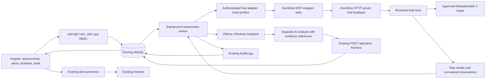

# Security assessment integration: discovery and proposal

Date: 2026-09-25 (Asia/Beirut). Status: discovery complete within available access; implementation proposal awaiting approval per supplied requirements sections 19-20.

This report distinguishes observed configuration, historical evidence, and proposed changes. No application code, database schema, VM, network setting, or model installation was changed during discovery. Only basic ICMP reachability checks to the two historical lab VM addresses were performed after the user started the VMs; no port/vulnerability scans or exploitation were run. Existing application work remains in place.

## 1. Current environment

| Area | Observed result | Limitation |
| --- | --- | --- |
| Host | Windows 11 Pro, version 10.0.22631 | Queried locally |
| CPU | Intel Core i5-7200U, 2 physical cores / 4 logical processors | CPU-bound local inference expected |
| RAM | About 15.9 GiB usable; about 7.0 GiB free at first observation | Availability changes with VMs and development tools |
| GPU | Intel HD Graphics 620; WMI reports 1 GiB AdapterRAM | Integrated/shared graphics; this is not proof of dedicated VRAM or supported GPU acceleration |
| Storage | After user reconnected disk: C: about 172.2 GiB total / 2.1 GiB free; D: about 59.0 GiB total / 48.0 GiB free | Initial discovery had only C: visible; no cleanup performed |
| VMware | Workstation 17.6.3 build-24583834 | After user startup, vmrun reports both intended VMs running |
| Kali | Existing Kali 2026.2 VMX found; 4 vCPUs, 2048 MiB RAM, e1000 NIC | Running after user startup; VMware Tools heartbeat observed but getGuestIPAddress fails. Guest packages not inspected |
| Metasploitable | VMware inventory records metasploitable3-win2k8 at D:/metasploitable3/output-vmware-iso/metasploitable3-win2k8.vmx | D: restored by user; VMX now verified: 2 vCPUs, 4096 MiB RAM, e1000e, NAT, running in VMware. VMware Tools unavailable |
| Additional VM | Inventory also contains a Windows Server 2008 R2 VM under OneDrive/Documents/Virtual Machines | Do not substitute it for the approved Metasploitable target |
| Backend | ASP.NET Core net10.0; EF Core 9.0.8; Pomelo 9.0.0; FluentValidation; Serilog | Preserve working versions; no provider upgrade proposed |
| Frontend | Angular 22.1, standalone, zoneless, strict TS, Vitest, lazy routes | Existing authentication and UI retained |
| Database | Installed MySQL Server 8.0.43; MySQL80 running; port 3306 listening | Configured database incident_management on localhost:3306; no fresh SQL/schema verification in this discovery |
| App services | No listeners found on checked frontend/API ports 4200/7146 | Application was stopped |
| HexStrike | Integration account seeding and configuration keys exist in backend | No local listener on checked 8888 port; Kali installation/version unknown |
| Ollama | .ollama directory exists; no model manifests found | No ollama executable found on PATH, no installed-app entry found, no listener on 11434. Directory alone does not prove an installed runtime |
| Python connector | Not found among repository source files | May exist inside Kali or elsewhere. Obtain its path and inspect before replacing/duplicating |
| Containers | No Dockerfile/compose file found in source tree | Docker is deferred in current architecture |

Secrets were checked for presence only; passwords, signing keys, connector credentials and full connection strings are intentionally omitted.

## 2. Current network and evidence

| Component | Address/configuration | Confidence |
| --- | --- | --- |
| Windows VMnet8 | 192.168.207.1/24 | Current host adapter |
| VMware NAT gateway | 192.168.207.2/24 | vmnetnat.conf |
| Windows VMnet1 | 192.168.88.1/24 | Current host-only adapter |
| Windows Wi-Fi | 192.168.0.104/24 | Current physical-network address; not an approved target |
| Kali | 192.168.207.130, MAC 00:0c:29:1a:97:ff | Historical DHCP lease from September 24, matching Kali VMX MAC; expired, not a current live IP |
| Likely Metasploitable | 192.168.207.129, hostname vagrant-2008R2, MAC 00:0c:29:df:c8:71 | Renewed DHCP lease at 2026-09-24 22:45:02 UTC; MAC matches verified target VMX and current host ARP. ICMP echo did not reply |

Kali's latest inspected VMware log records NAT at startup on September 24, then unsets ethernet0.connectionType later. The current VMX does not explicitly specify connectionType. Therefore NAT is historical evidence, not a verified current attachment. After D: was reconnected, Metasploitable VMX explicitly confirmed NAT.

DHCP ranges: VMnet8 192.168.207.128-254; VMnet1 192.168.88.128-254. Inspected NAT configuration has empty incoming TCP/UDP forwarding sections. This does not establish absence of every host/router forwarding rule. NAT normally permits outbound traffic and is not equivalent to an isolated lab.

**Kali-to-Metasploitable connectivity is not verified.** Both VMs are now running. Metasploitable has a fresh lease and matching MAC at 192.168.207.129; host ping did not receive an echo reply (a guest firewall could explain this). Kali still has only an expired lease at 192.168.207.130, no resolved ARP MAC, and no guest IP returned by vmrun. Obtain guest IP/routes and verify NIC connection before allowlist seeding. A host-unreachable response from 192.168.207.1 is not a reply from Kali.

Proposed networking, after verification and approval: attach the vulnerable target to VMnet1 host-only; give Kali a lab NIC on that same network. If Kali needs NAT for package/model preparation, keep that separate and disable routing/forwarding between NICs. Do not bridge the target to Wi-Fi or add Internet-facing port forwards. No network change is necessary for building the missing ordinary application screens.

## 3. Existing application architecture and gaps

Browser -> Angular -> JWT-authenticated ASP.NET controllers -> services -> AppDbContext -> MySQL. Evidence bytes live in private filesystem storage. DTOs and FluentValidation isolate API contracts; services own authorization/transactions. Request auditing uses IAuditContext and transactional SaveChangesAsync; Serilog is diagnostic logging, not the canonical audit trail.

| Area | Existing API/domain | Missing application surface or backend gap |
| --- | --- | --- |
| Auth | Login, refresh, logout, me, change-password | Profile/current-user and change-password screen |
| Incidents | List/create/detail/edit/assign/status/close | Comments, timeline, response-action create/update screens |
| Incident associations | Link/unlink IOCs, assets and MITRE | Link management UI; GET collection routes are documented but absent, and incident detail DTO has no associated collections |
| Alerts | List with status/source filters; detail/create/promote/false-positive | All alert screens, raw evidence view, promotion flow |
| IOCs | List filters/search, lookup, create/detail/update, incident appearances | Catalog, lookup, forms and correlation navigation |
| Assets | List/create/detail/update and incident appearances | Inventory, manager/admin forms and correlation navigation |
| MITRE | Tactics, filtered techniques, technique detail, incident linking | Reference browser and mapping UI. No technique authoring API; do not invent editing screens |
| Evidence | List/upload/download/delete | Already implemented in UI |
| Users | Directory/create/profile/roles/deactivate | Already implemented in UI |
| Dashboard | Eight aggregation endpoints | Already implemented in UI |
| Audit | AuditLogs model/table/writes | Audit read controller/service/DTOs and UI are absent, despite planned routes in docs |
| Assessments | None | Background assessment lifecycle, target allowlist, controlled adapter, local LLM integration and UI |

Important implementation facts:

- AlertSource.PenTest exists (numeric API enum value 6), and IncidentSource supports promotion. Findings must remain Alerts.
- Alert.RawPayload is a MySQL JSON column. Preserve tool stdout/stderr as exact string values (or base64 for bytes) within a versioned envelope. MySQL JSON is not a byte-for-byte archive of the submitted JSON document: preserve/have hashes for original bytes separately when needed.
- Alert.DeduplicationKey exists and is unique, but AlertCreateRequest/CreateAsync do not currently populate it. Assessment retries need a compatible ingestion extension, otherwise duplicate alerts are possible.
- Alert severity is source-reported text; incident severity is a separate enum chosen during promotion. Do not turn an open port or uncertain banner match into a confirmed vulnerability.
- Integration account seeding assigns SOC_ANALYST and credentials are configured. This is not evidence that the connector script or HexStrike service is installed/working.
- RequestAuditContext.IsActive depends on HttpContext. Background workers must explicitly establish actor/audit scope or write auditable events transactionally; existing request-only capture will otherwise miss them.
- Security and database documents contain stale claims (no migrations/controls implemented, EF Core 10, deactivation grace period). Actual project has migrations, EF Core 9 and per-request active-user/current-role checks. Reconcile documentation as implementation proceeds.
- List/search support differs from planned API tables. UI should expose only implemented filters, or implement the missing API feature explicitly.

## 4. HexStrike interface investigation

Upstream inspection shows two layers, not a REST endpoint invented from MCP terminology:

1. hexstrike_server.py runs a Flask HTTP tools server, with default 127.0.0.1:8888, /health and real routes such as POST /api/tools/nmap.
2. hexstrike_mcp.py creates a FastMCP server and wraps the HTTP tools API. Its main function invokes mcp.run(); the default MCP transport must be confirmed against the installed SDK/version. It is intended for an MCP client, not direct JSON POSTs from Angular.

The Kali package exposes hexstrike_server and hexstrike_mcp. Upstream is evidence of the available design, **not verification of the package inside the Kali guest whose installed packages remain uninspected**. Before execution, record the installed version/commit, --help output, MCP initialization/tools/list, response schemas, authentication behavior, and timeouts. Do not assume a fork's API-key support exists in the installed package.

Proposed integration: a small authenticated Kali adapter acts as an MCP client, launches the installed hexstrike_mcp through stdio, and exposes a narrow job interface to the ASP.NET worker. That adapter is NEW application integration code; its endpoints are not existing HexStrike endpoints. It only exposes reviewed tool profiles and validated parameters, not arbitrary commands or the entire MCP tool catalog. HexStrike's HTTP server remains loopback-only on Kali.

Direct HTTP integration is technically possible, but the MCP adapter preserves an explicit, demonstrable MCP path for this assignment. Windows Ollama is called by the ASP.NET orchestrator; no cloud LLM or Kali-to-Ollama network exposure is necessary. The model cannot independently authorize tool execution.

Sources inspected:

- [Kali HexStrike package](https://www.kali.org/tools/hexstrike-ai/)
- [Upstream HTTP server](https://raw.githubusercontent.com/0x4m4/hexstrike-ai/master/hexstrike_server.py)
- [Upstream MCP wrapper](https://raw.githubusercontent.com/0x4m4/hexstrike-ai/master/hexstrike_mcp.py)

## 5. Proposed architecture

Only orchestration records are new: ApprovedLabTargets and SecurityAssessments. No Findings table and no alternate audit-log table. Add an optional assessment FK to existing Alerts for reliable filtering/correlation. Store profile/version, scope, initiator, state, approval metadata, job lease/checkpoint and result artifact references on the assessment.

POST /api/security-assessments persists QUEUED and returns immediately (proposed 202 + Location). A database-backed worker claims jobs with concurrency control; polling GETs report saved state. Bound concurrency to one assessment initially on this hardware. Process restarts must not silently replay intrusive operations. Record interrupted jobs and require review where remote completion is uncertain.

Alert ingestion remains POST /api/alerts with extensions for assessment correlation and idempotency, using the existing connector identity and service. Audit records distinguish the initiating human, approver, and ingesting service account. Do not store an end user's JWT in a job or trust caller-supplied actor IDs.

Store collected facts in a versioned RawPayload envelope: assessment ID, target/IP, protocol/port/service/version, tool/version, execution time, original output, parser version, vulnerability identifiers, source severity/CVSS when supplied, confidence and evidence references. Description contains readable interpretation, clearly labeled as AI-generated where applicable. Prompt/response artifacts and model parameters are retained separately from immutable facts and referenced in AuditLogs. The audit table records metadata/references and sanitized parameters, not tokens or arbitrary sensitive payloads, consistent with docs/security.md.

## 6. Lifecycle and approval semantics

Start with the requested QUEUED -> RUNNING -> RECON -> SCANNING -> AWAITING_APPROVAL sequence, then explicitly separate two paths:

- Read-only assessment: normalize evidence -> LLM_ANALYSIS -> FINDINGS_CREATED (Alerts) -> COMPLETED. Users must be able to finish/report observations without consenting to exploitation.
- Intrusive verification: present the specific proposed test, target/port, evidence, expected effect and recovery plan. Only Manager/Admin can approve-exploitation; approval records the exact scope/profile/parameter digest, approver, expiry and assessment version. Only then may the worker run the approved vulnerability validation. Reject duplicate, expired, revoked or mismatched approvals. No generic approval for every discovered vulnerability.

A preliminary normalization/preview before approval is necessary: approvers need evidence to make an informed decision. The supplied lifecycle lacks an explicit exploitation state; add an explicit approved-verification state/outcome rather than conceal execution under LLM_ANALYSIS. Support failure, cancellation and partial output, and distinguish 'cancellation requested' from confirmed remote process termination. Exact state names are a proposal to approve before implementation.

## 7. Files and components to change

Existing files to extend, not replace:

- frontend/src/app/app.routes.ts, layout/shell.ts, core/services/auth.ts (safe return routes), styles.css.
- frontend/src/app/features/incidents/incident-detail.ts and typed incident models/services for child panels and linked resources.
- backend/IncidentPlatform.Api/Controllers/IncidentsController.cs; IOC/asset/MITRE interfaces/services/DTOs for missing association reads.
- backend/IncidentPlatform.Api/Program.cs for DI, worker and options registration.
- backend/IncidentPlatform.Api/Data/AppDbContext.cs and audit scope support for orchestration persistence and worker attribution.
- backend/IncidentPlatform.Api/Models/Alert.cs, DTOs/Alerts/AlertDtos.cs, Services/AlertService.cs, Validators/AlertValidators.cs, Data/AlertConfiguration.cs for optional assessment correlation/idempotency and bounded payload validation.
- backend/IncidentPlatform.Api/Configuration/ApiRateLimiting.cs for assessment-start/approval limits.
- docs/architecture.md, docs/database-design.md, docs/api-design.md, docs/security.md and frontend/README.md to reconcile actual contracts.

Proposed new files/folders:

- Frontend feature areas alerts/, iocs/, assets/, mitre/, audit/, account/, security-assessments/, and incident child components; typed services/models and tests.
- Backend Controllers/AuditLogsController.cs; Interfaces/IAuditLogService.cs; Services/AuditLogService.cs; DTOs/AuditLogs/.
- Backend Models/ApprovedLabTarget.cs, Models/SecurityAssessment.cs and respective Data/ configurations; EF migration.
- Backend assessment/target controllers, service interfaces, services, DTOs, validators and typed options following existing conventions.
- Backend background worker, bridge client, Ollama client and evidence normalizers with contract/authorization/lifecycle tests.
- integrations/hexstrike-adapter/ for the narrow MCP bridge and tests, after inspecting the existing connector.
- docs/lab/ for installation evidence, pinned tool versions, architecture, model sheet, three-trial benchmark, scenarios, report and safeguards sheet.

## 8. Dependencies and local model proposal

Keep Angular and backend dependency versions. ASP.NET BackgroundService/HttpClient are sufficient for initial orchestration; use existing MySQL for durable job state rather than adding Redis/Hangfire immediately. On Kali, verify/install HexStrike and only the selected tool dependencies; use a pinned Python environment/MCP SDK for the adapter. Confirm an authenticated transport (e.g. SSH tunnel or TLS-protected narrow adapter); do not expose unauthenticated HexStrike routes.

For Windows, a provisional starting point is qwen3:1.7b quantized through Ollama, modest context (initially 2048) and bounded output, one request at a time. This is a trial choice, not a performance claim. The official model tag currently lists about 1.4 GB download size; working RAM includes runtime/context overhead. C: free space fell to about 2.1 GiB with the VMs running; D: now has about 48.0 GiB free. Propose D: for models/artifacts after confirming it will remain attached. Agree the storage location first; no files were deleted.

Use Windows loopback for Ollama, disable cloud features (documented OLLAMA_NO_CLOUD=1), select an installed local model and record its digest/parameters. Prove local inference using endpoint/process/network evidence and a run without Internet access, not merely a model-name string. Measure at least three identical prompt trials, distinguishing cold/warm timings; save actual results, not estimates. Inspect whether the small model reliably follows evidence schemas before allowing it to propose any reviewed tool plan. The security policy must work even if the model produces invalid or hostile output.

References: [Model tag](https://ollama.com/library/qwen3:1.7b), [Ollama local-only/network FAQ](https://docs.ollama.com/faq).

## 9. Controls, risks and acceptance checks

- ApprovedLabTargets is an explicit database allowlist with approver/time/description/active state. Reject unlisted IPs, including private IPs. Verify real target identity first; DHCP reassignment can invalidate approval. No public targets by default.
- Recheck target authorization at execution and approval, not only enqueue. Fix service destinations in server configuration; never allow target input to select the bridge/Ollama URL.
- Strict profile/parameter allowlists, single-IP canonicalization and fixed tool selection. No arbitrary shell text, user-supplied flags, generic command endpoint, or unvalidated LLM tool calls.
- Approval gates apply to intrusive testing as well as exploitation. Tool labels alone do not prove a scan is non-intrusive; review selected scripts/templates and disable automatic recovery/escalation that changes scope.
- Preserve raw outputs and hashes with bounded retention/storage and controlled access. Imported tool text/LLM text stays escaped in Angular; it is untrusted input, including prompt-injection content.
- Severity requires source/evidence/rationale and confidence. Missing score is unknown, not zero or fabricated CVSS. A service banner suggests a candidate issue; it does not establish successful exploitation.
- Existing AuditLogs records every transition, approval, execution identity/profile, tool/model version, timing, output references, ingestion IDs and failure. Do not enable blanket raw secret logging to achieve traceability.
- Tests must prove allowlist rejection, analyst approval denial, approval replay protection, restart/idempotency behavior, timeouts/cancellation, malformed output handling, no fabricated findings, JWT/route restrictions and alert promotion.
- A full penetration-test report includes scope, methodology, reviewed validation, evidence, impact, remediation, retest and limitations. No scanner can establish that every weakness has been found.
- The PDF also specifies reconnaissance of megacorpone. Preserve it as a separate scoped assignment scenario; this discovery does not authorize or perform public-target scanning.

## 10. Implementation sequence after approval

Complete ordinary missing UI/API coverage as a separate first workstream; VM access is not a dependency for Alerts/IOCs/Assets/MITRE/incident-child/account/audit screens. Then follow the requested lab sequence:

1. Target disk restored and both VMs started by user. Next verify Kali NIC/IP, guest routes and Kali-target connectivity; record actual IPs and approved scope.
2. Verify installed HexStrike server, MCP startup/tools and tool versions; capture logs.
3. Install/verify Windows local LLM after storage review; record hardware/model sheet and three timing trials.
4. Verify the adapter/MCP/HexStrike and local-LLM orchestration path using harmless connectivity checks.
5. Run a narrowly scoped approved discovery/scan job; persist lifecycle and raw outputs.
6. Normalize real results with parser provenance and severity/confidence rationale.
7. Analyze evidence locally; preserve exact prompts, responses and model parameters separately from facts.
8. Ingest through the existing Alerts API with idempotency; test promote-to-Incident.
9. Render assessment status, services, evidence, AI analysis and linked Alerts in Angular.
10. Add and exercise the explicit Manager/Admin approval workflow for a selected lab-only verification/exploitation scenario after the prior phases pass.
11. Verify complete AuditLogs attribution, raw-evidence references and failure/cancellation records.
12. Produce actual screenshots/logs, report, appendix, limitations and one-page safeguards sheet. Mark any unexecuted scenario unverified.

## 11. Required user input / approval

- D: restoration and target VMX verification are complete. Obtain Kali output from `ip -br a` and `ip route` to finish network discovery; do not rebuild either VM.
- Provide the existing Python connector path (possibly inside Kali); guest access is needed to verify HexStrike and tool installation.
- Approve this extension architecture and the staged implementation. Networking/model downloads remain explicit changes to review once actual VM state and storage are available.

The supplied requirement explicitly says: "Then STOP and wait for my approval before making large architectural changes." This report is the concrete discovery deliverable for that checkpoint. No claim is made that HexStrike, local inference, scanning, or the new interfaces have been implemented or validated yet.
