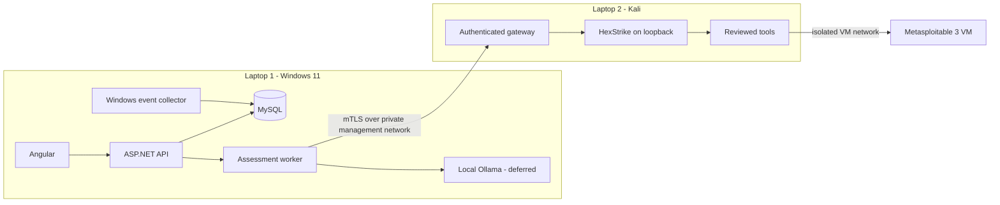

# Two-laptop security assessment architecture

Assessment date: 2026-09-25. Proposal only: no HexStrike execution or assessment implementation authorized in this review. This document supersedes the single-host network assumptions and obsolete UI-gap list in security-assessment-discovery.md. Approval is requested because section 20 of the newly supplied user requirements explicitly requires stopping after the architecture assessment.

## A. Current architecture and verified state

| Component | Observed implementation |
| --- | --- |
| Angular | Angular 22 standalone, zoneless, signals, lazy routes, Vitest; shared CSS and authenticated HTTP client |
| API | ASP.NET Core net10.0; controllers/services/DTOs, FluentValidation, EF Core 9.0.8 and Pomelo 9.0.0 |
| Database | MySQL; migrations; incidents, alerts, IOCs, assets, MITRE, evidence metadata, users, roles and AuditLogs |
| Authentication | JWT access tokens, HttpOnly refresh cookies, active-user and current-role validation per request |
| Security | Role checks, transactional request audit writes, rate limits, security headers, database readiness |
| UI | Dashboard, incidents and investigation workspace, evidence, alerts, IOCs, assets, MITRE, users, audit, account and lab health checks |
| HexStrike | LabConnections only checks health. No assessment queue, runner, target allowlist, execution history or result parser |
| Ollama | Not verified installed/running. Installation was deferred. No evidence-analysis integration exists |
| Windows logs | Separate collector, read APIs and Angular page have been written; migration is applied. Collection is NOT enabled or validated end to end; zero stored events. Security channel access was denied under the current Windows identity |
| Service state | At review time no listeners on checked application/model ports; the API remains stopped following the earlier implementation work |

Earlier authorized cleanup removed 35 fixture alerts, 2 fixture incidents and 40 fixture assets. Eleven proven test accounts were deactivated to preserve role attribution. Existing audit history was retained. Backup: logs/backups/before-windows-events-20260925-153412.sql (ignored by Git; contains sensitive database data). Current business counts were verified as zero. Integration fixture code now selects incident_management_tests; that database exists, but the interrupted test run's final result was unavailable and is not claimed as passing.

Windows collection still needs its own tests, deployment/permission verification and operational review. It must not be presented as completed because source files and a migration exist. This review makes no further implementation changes.

## B. Required changes and reuse

Add a Security Assessment feature within the existing shell and API, with a durable worker rather than a long-running browser request. Reuse authentication, roles, audit records, AlertSource.PenTest, IOC/asset association, and promotion into incidents. Do not add a second Findings catalog duplicating Alerts.

Proposed minimal persistence:

- AssessmentTarget: approved host identity, literal lab address, scope, enabled state, reviewer, approval time and scope revision; never a free-form command destination.
- SecurityAssessment: requester, target/scope snapshot, selected profile/version, immutable parameters, state, timestamps and errors; durable queue lease and execution correlation.
- AssessmentExecution: attempts and remote job IDs; prevents retrying an ambiguous invocation as a new scan.
- AssessmentEvidence: original response/output bytes or private-file references with SHA-256, tool/version/parameters/timestamps, parser version and structured observations. Existing Evidence requires IncidentId, so assessments must not create fake incidents just to store evidence. Reuse storage/validation services; introduce assessment ownership cleanly.
- AssessmentAlert association: links normalized actionable findings to existing PenTest Alerts with deterministic deduplication.
- AssessmentApproval: approver, action, target/scope/parameter hash, expiry, outcome and audit correlation.
- AssessmentAnalysis: separate, versioned model output linked to evidence hashes and model/prompt versions. AI text cannot modify raw evidence or authoritative severity.

An open port remains an informational observation, not an automatically confirmed vulnerability. Tool-supported severity and its source must remain visible; absent evidence means unknown severity. Dashboard incident counters stay incident counters; assessment observations and Windows event volume are shown separately.

## C. Real HexStrike interface and integration choice

Verified against upstream source, not the uninspected Laptop 2 installation: Flask defaults to 127.0.0.1:8888; GET /health reports tool availability. POST /api/tools/nmap accepts target, scan_type, ports, additional_args and use_recovery. Execution results include stdout, stderr, return_code, success, timed_out and partial_results; validation/exceptions also return errors. The inspected routes show no authentication guard. Shell execution, cached results, automatic recovery and mock CVE correlation code require explicit controls. [Server source](https://raw.githubusercontent.com/0x4m4/hexstrike-ai/master/hexstrike_server.py)

Kali provides hexstrike_server --port and hexstrike_mcp --server/--timeout. The MCP wrapper registers tools including nmap_scan and forwards calls to HTTP; it calls mcp.run(). Inspect installed MCP transport before claiming remote MCP support. [Kali package](https://www.kali.org/tools/hexstrike-ai/), [MCP wrapper](https://raw.githubusercontent.com/0x4m4/hexstrike-ai/master/hexstrike_mcp.py)

Recommended boundary: a small authenticated Kali gateway with a narrow job protocol, managed as a service. This gateway is NEW application code, not an existing HexStrike API. ASP.NET communicates with it over mutually authenticated HTTPS. HexStrike remains bound to Kali loopback. Angular talks only to ASP.NET.

Use the real HTTP tool interface behind that boundary for the first validated profile; it is sufficient for web orchestration and does not inherently require MCP. If the assignment requires an actual MCP session, the gateway can instead be an MCP client using the installed stdio wrapper and tools/list + tools/call. Validate the selected transport and record the handshake; never label REST traffic as MCP. The wrapper's recovery behavior must be reviewed before approving that path.

Tool choices shown in the UI are the intersection of actual installed availability, successfully validated adapter capabilities and approved profiles. Health availability is not proof that a scan succeeded. The deployed package version, executable help, interface schemas, authentication and timeout behavior remain unverified on Laptop 2. The user's earlier healthy v6.0.0 response came from the previous Kali environment; it is not evidence for the new physical machine.

No arbitrary shell, raw additional_args, generic command/file endpoints or automatic exploit selection is exposed. Disable or reject recovery that changes approved tool/scope. Require fresh-output provenance: if installed caching cannot be disabled or reliably detected, block acceptance as a fresh assessment until that behavior is resolved.

## D. Two physical laptops and network

Two separate network paths:

1. Management: Laptop 1 reaches only the gateway's configured private address/port on Laptop 2. Firewall limits access to Laptop 1. Certificates/keys remain server-side, with peer identity verification. Do not publish raw port 8888, MySQL or Ollama on the LAN.
2. Target lab: Kali reaches Metasploitable on an isolated virtual network. The vulnerable VM has no home-LAN bridge or public port forward. Disable forwarding between management and lab networks. Laptop 1 does not need direct access to the target VM.

No current Laptop 2 management address or gateway identity is known. The former 192.168.207.x VMnet8 addresses must not be reused as assumed two-laptop addresses. Configure gateway URL/certificate identity, local HexStrike endpoint and approved target independently; store secrets outside source control. The current Lab:HexStrikeUrl health checker is not an authenticated assessment transport and must be upgraded/replaced for this boundary.

Existing Metasploitable VM: shut it down cleanly, copy the complete VM directory including all referenced VMDK/snapshot files, verify hashes, import/open the VMX in a compatible VMware installation on Laptop 2, choose the isolated network before boot, and verify the new IP. Inspect hardware/hypervisor compatibility and disk capacity first. No Packer rebuild is assumed necessary; copying only the VMX is insufficient. This is a transfer plan, not a completed transfer.

## E. Workflow, failure handling and safeguards

User selects an approved target and reviewed capability. API validates role, current approval/scope revision and parameters, commits the assessment and audit event, and returns its ID. Worker submits an idempotent remote job; UI polls persisted state (or later uses authenticated push). No percentage is fabricated when the tool supplies no progress.

Lifecycle: Pending -> Running -> Completed / Failed / CancelRequested -> Cancelled, with AwaitingApproval before intrusive actions. Timeout/unknown remote outcome is not success and is not safe to retry blindly. Cancellation is complete only when remote execution termination is confirmed. Application restart resumes job reconciliation; it does not rerun an exploit.

Persist raw output before parsing, including partial output from failed/timed-out tools. Malformed responses fail clearly while retained evidence remains inspectable. Size limits must flag truncation or spool to bounded storage, never silently discard evidence. Completion, transport connectivity, installed-tool availability and AI-analysis readiness are separate statuses.

Controls belong in the first executable phase: approved targets and immutable scope, schema validation, command-injection prevention, tool/profile allowlist, concurrency limits, timeouts, rate limits, audit events, restricted service identities and isolated networking. DNS/redirect changes cannot broaden target scope. Intrusive execution requires a fresh manager/admin approval bound to the exact action; no automatic exploitation of every finding.

Audit worker events explicitly: request, validation, approval, dispatch, receipt, parsing, cancellation and analysis. The current request-scoped audit mechanism alone does not cover a background worker.

Treat tool output as untrusted text in the UI and as untrusted evidence in model prompts. Ollama receives bounded evidence references, has no execution tools or authority to approve actions, and writes analysis separately. If Ollama is unavailable, completed tool evidence remains usable. Vulnerability databases/templates/models must be locally staged for an offline demonstration; optional upstream online intelligence is outside the offline execution path.

## F. Implementation phases and acceptance evidence

| Phase | Deliverable and acceptance gate |
| --- | --- |
| 1 | Record both physical hosts, private management connectivity and isolation. Reconcile the unfinished Windows collection work independently. |
| 2 | Inspect installed Kali/HexStrike version, start options, real interface and credentials/transport; record capability discovery. |
| 3 | Import the existing Metasploitable VM, verify isolated addressing and Kali-only target reachability. |
| 4 | Execute one explicitly scoped non-intrusive profile and capture genuine output, error and freshness behavior. |
| 5 | Build authenticated gateway, API/worker, minimal migrations, allowlist, approvals and auditing together. |
| 6 | Add Angular target/profile selection, state/history, evidence and findings using the existing design. |
| 7 | Verify persistence, deduplication, restart/retry/timeout/cancel behavior and incident promotion. |
| 8 | Install/validate local Ollama later; add evidence-grounded analysis with provenance and no execution authority. |
| 9 | Exercise approval gates, scope rejection, injection resistance, role restrictions and disconnected-service errors. |
| 10 | Run the entire workflow from the browser across both laptops; preserve screenshots, raw evidence and audit records for the assignment. |

Stop here for architecture approval. No network scan, VM transfer, model installation or HexStrike feature implementation was performed in this review. Real execution remains gated on inspecting Laptop 2 and confirming its target scope.
